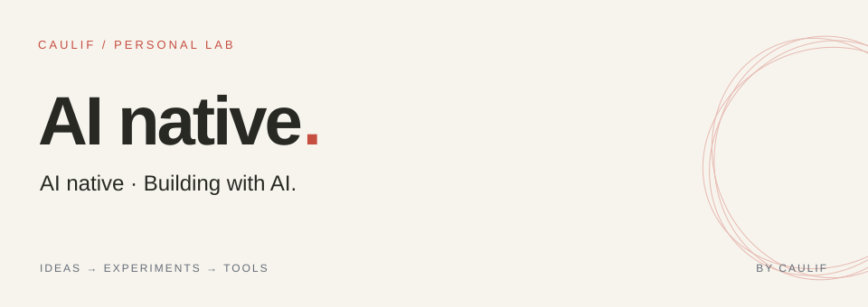

<picture>
  <source media="(prefers-color-scheme: dark)" srcset="./banner-dark.svg">
  <source media="(prefers-color-scheme: light)" srcset="./banner-light.svg">
  
</picture>

Hi, I'm caulif.

Building with AI, and taking it apart to understand how it works.

## What I'm building

### ↺ Reprise

Replay a coding-agent task from the same starting point, try another runtime, and compare the results. Local-first and experimental.

[Explore project ↗](https://github.com/caulif/Reprise)

### ›_ mini-agent

A handwritten Python coding agent. Seven chapters in English and Chinese make the model, tools, and execution loop visible.

[Explore project ↗](https://github.com/caulif/mini-agent) · [Read the guide ↗](https://caulif.github.io/mini-agent/guide.html)

---

Always learning. Always building.
